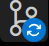
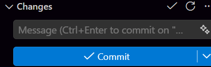

# Chapter 8: Saving and sharing
To save, go to the icon that has a number, and a branch like this:

And then you need to fill the space with a message:

You press the tiny arrow, then choose "Commit & Sync"
## Publishing
To publish, go to your Repo online, then click release, or package, depending what are you publishing! I do not know what does packageing do but do not click it!